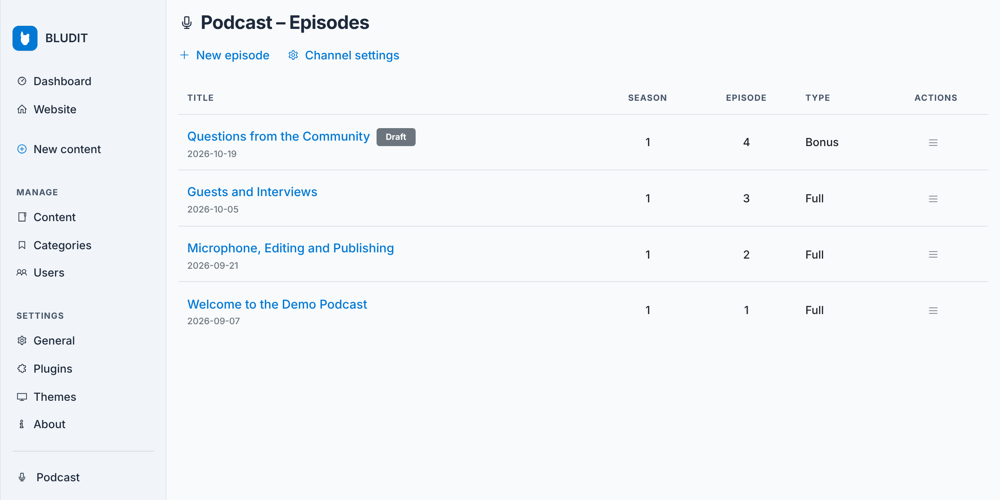
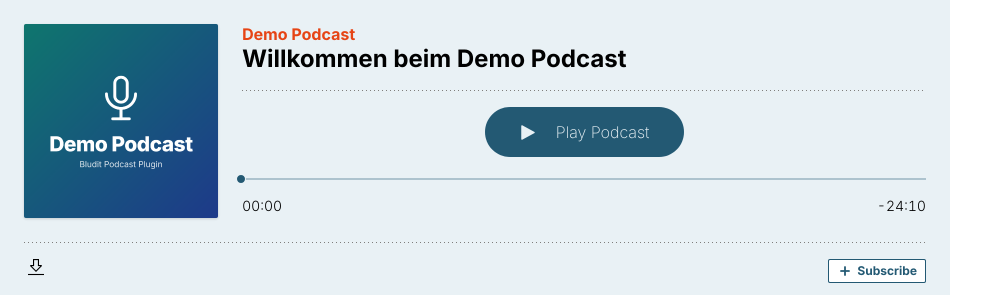
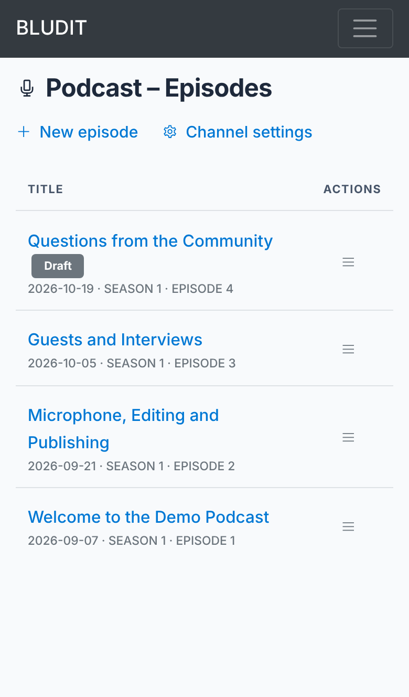
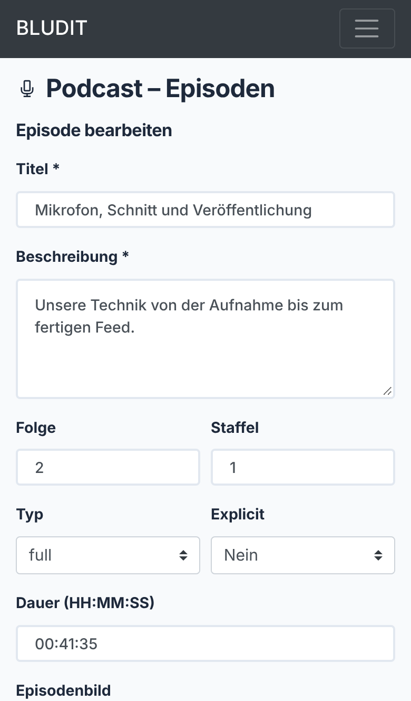

# Bludit Plugin: Podcast

Run a podcast with [Bludit](https://www.bludit.com): manage episodes in the admin panel, publish an RSS feed with iTunes tags, and play episodes on your site with the Podlove Web Player – served from your own server.

> **Status:** in development. Version 1.0 is being prepared. The plugin files and downloads will be published here – watch this repository to get notified.

## Features

- **Episodes are regular Bludit pages** with the tag `podcast`, so they work with your theme, categories, tags and the Bludit editor. Episode details (number, season, type, duration, audio, artwork) are stored as Bludit custom fields.
- **Admin page** to create, edit and delete episodes. Upload audio and episode artwork or link external files; uploads are checked for size, file type and content. Matches the Bludit admin look and works on phones.
- **RSS feed** at `/podcast.xml` (configurable) with iTunes tags for episode, season, type, duration, explicit and artwork.
- **Player on episode pages:** Podlove Web Player 5 served from your own server – no CDN, no third-party requests – or a simple HTML5 player.
- Works with Bludit installed in a subdirectory.

## Screenshots

**Episode page with the Podlove Web Player**

| Episode list on a phone | Editing an episode on a phone |
|---|---|
|  |  |

## Requirements

- Bludit 3.19 – 3.22
- PHP 8.0 or newer with the `fileinfo` extension (for uploads)

The admin interface follows the language of your Bludit site: English or German (Germany, Austria, Switzerland).

## License

All rights reserved. The license for the first release will be announced here.

---

## Deutsch

Podcast-Plugin für [Bludit](https://www.bludit.com): Episoden im Admin-Bereich verwalten, RSS-Feed mit iTunes-Tags, Podlove Web Player direkt vom eigenen Server – ohne CDN und ohne Drittanbieter. Episoden sind normale Bludit-Seiten mit dem Tag `podcast`. Die Oberfläche folgt der Sprache der Bludit-Website: Deutsch oder Englisch.

Version 1.0 ist in Vorbereitung; Plugin-Dateien und Downloads erscheinen hier. Voraussetzungen: Bludit 3.19–3.22, PHP 8.0 oder neuer.
